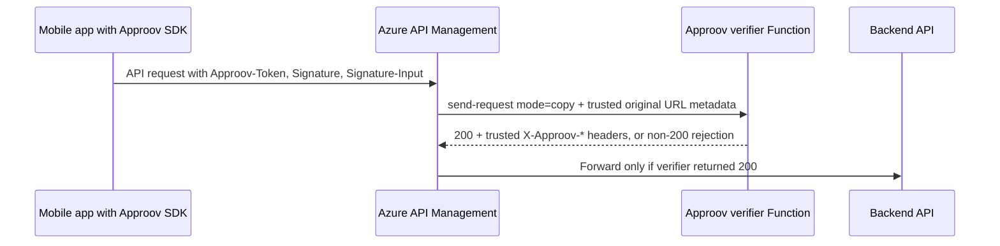

# Approov Token Verifier for Azure Functions

This repository provides an Approov verifier for Azure API Management (APIM). APIM stays as the public API gateway. Before APIM forwards a protected request to a backend API, it mirrors the request to a .NET 8 isolated Azure Function. The Function validates the Approov token, optional token binding, HTTP message signature, and optional content digest, then returns a compact allow/deny response to APIM.

The intended production architecture is:



## What This Verifies

The verifier is based on the Approov ASP.NET token-check quickstart behavior and is designed for APIM-fronted APIs.

| Protection | Behavior |
| --- | --- |
| Approov token | Reads `Approov-Token`, validates JWT/JWS format, validates HS256 with `APPROOV_BASE64_SECRET`, requires `exp`, and rejects expired or incorrectly signed tokens. |
| Device id | Extracts `did` when present and returns it to APIM as `X-Approov-Device-Id` on success. |
| Token binding | When configured, hashes selected request header values and compares the result with the token `pay` claim. |
| Message signing | Verifies `Signature` and `Signature-Input` using the installation public key in the token `ipk` claim. |
| Content digest | Validates `Content-Digest` when present, supporting `sha-256` and `sha-512`. |
| Gateway metadata | Reconstructs the request signed by the mobile app from APIM-supplied `X-Approov-Original-*` headers, not from the Function URL. |

## Repository Layout

| Path | Purpose |
| --- | --- |
| `src/Approov.Validation` | Reusable C# validation library. |
| `src/Approov.Validation.Functions` | .NET 8 isolated Azure Function exposing `/api/approov/verify`. |
| `apim/approov-validation-fragment.xml` | APIM inbound policy fragment for protected APIs. |
| `samples/Approov.ShapesApi.Functions` | Optional Shapes-compatible demo backend for Approov quickstart testing. Do not deploy this for customer production. |
| `tests/Approov.Validation.Tests` | Unit and Function-adapter tests. |
| `.github/workflows/dotnet.yml` | GitHub Actions build, test, and coverage workflow. |
| `docs/AZURE_TESTING.md` | Azure integration test plan and effort estimate. |

## Production Vs Demo Assets

Customer production deployments need only:

- `src/Approov.Validation`
- `src/Approov.Validation.Functions`
- `apim/approov-validation-fragment.xml`
- The customer's own APIM APIs and backend services

The `samples/` directory is not part of the verifier product. It exists only to give Approov a repeatable end-to-end demo target when a real customer backend is not available. In customer environments, APIM should forward validated requests to the customer's existing backend API instead of the sample Shapes Function.

## Production Prerequisites

You need:

- An Approov account and Approov CLI access with permission to read the account secret.
- The protected API domain registered in Approov.
- Mobile apps integrated with the Approov SDK and configured to send `Approov-Token`.
- For message signing, mobile apps must send `Signature` and `Signature-Input` in the same HTTP message-signing format used by the Approov ASP.NET quickstart.
- Azure CLI authenticated to the target subscription.
- Permission to create or modify:
  - Azure Functions
  - Azure Storage
  - Azure Key Vault
  - Azure API Management
  - Microsoft Entra app registrations or Function App authentication settings
  - Azure role assignments

Register the Azure providers if the subscription has not used these resource types before:

```bash
az provider register --namespace Microsoft.Web --wait
az provider register --namespace Microsoft.Storage --wait
az provider register --namespace Microsoft.KeyVault --wait
az provider register --namespace Microsoft.ManagedIdentity --wait
az provider register --namespace Microsoft.Insights --wait
az provider register --namespace Microsoft.OperationalInsights --wait
```

## Approov Setup

Register the API domain with Approov if it has not already been added:

```bash
approov api -add api.example.com
```

Export the Approov account secret in base64 form. Store this only in a secret manager such as Azure Key Vault.

```bash
approov secret -get base64 -plain
```

Do not commit this value, put it in APIM named values, or pass it to the backend. The Function is the only component in this architecture that needs the Approov account secret.

For token binding, decide which stable request header values should be bound into the token. `Authorization` is the usual choice when the mobile app also authenticates the user. Avoid rapidly changing values because the SDK clears cached Approov tokens when the binding data changes.

For message signing, make sure the mobile client signs the Approov token as one of the covered components. This prevents replay of a valid signature with a different token.

## Azure Production Deployment

The commands below use a Premium Function plan. Premium is preferred for production because the verifier is on the request path and should not add cold-start latency. Azure Functions Premium supports always-ready and prewarmed instances.

Set deployment variables:

```bash
SUBSCRIPTION_ID="<subscription-id>"
LOCATION="westeurope"
RESOURCE_GROUP="rg-approov-verifier-prod"
STORAGE_ACCOUNT="<globally-unique-storage-name>"
PLAN_NAME="plan-approov-verifier-prod"
FUNCTION_APP="func-approov-verifier-prod"
KEY_VAULT="<globally-unique-key-vault-name>"
APP_INSIGHTS="appi-approov-verifier-prod"
APIM_NAME="<existing-apim-name>"

az account set --subscription "$SUBSCRIPTION_ID"
```

Create the resource group:

```bash
az group create \
  --name "$RESOURCE_GROUP" \
  --location "$LOCATION"
```

Create the storage account required by Azure Functions:

```bash
az storage account create \
  --resource-group "$RESOURCE_GROUP" \
  --name "$STORAGE_ACCOUNT" \
  --location "$LOCATION" \
  --sku Standard_LRS \
  --kind StorageV2 \
  --min-tls-version TLS1_2 \
  --allow-blob-public-access false
```

Create an Elastic Premium Function plan:

```bash
az functionapp plan create \
  --resource-group "$RESOURCE_GROUP" \
  --name "$PLAN_NAME" \
  --location "$LOCATION" \
  --sku EP1 \
  --is-linux true \
  --min-instances 1 \
  --max-burst 10
```

Create the Function App with a system-assigned identity:

```bash
az functionapp create \
  --resource-group "$RESOURCE_GROUP" \
  --name "$FUNCTION_APP" \
  --storage-account "$STORAGE_ACCOUNT" \
  --plan "$PLAN_NAME" \
  --runtime dotnet-isolated \
  --runtime-version 8 \
  --functions-version 4 \
  --os-type Linux \
  --https-only true \
  --assign-identity "[system]"
```

Create a Key Vault and store the Approov secret:

```bash
az keyvault create \
  --resource-group "$RESOURCE_GROUP" \
  --name "$KEY_VAULT" \
  --location "$LOCATION" \
  --enable-rbac-authorization true

az keyvault secret set \
  --vault-name "$KEY_VAULT" \
  --name "approov-base64-secret" \
  --value "<approov-secret-from-cli>"
```

Allow the Function App identity to read Key Vault secrets:

```bash
FUNCTION_PRINCIPAL_ID=$(
  az functionapp identity show \
    --resource-group "$RESOURCE_GROUP" \
    --name "$FUNCTION_APP" \
    --query principalId \
    --output tsv
)

KEY_VAULT_ID=$(
  az keyvault show \
    --resource-group "$RESOURCE_GROUP" \
    --name "$KEY_VAULT" \
    --query id \
    --output tsv
)

az role assignment create \
  --assignee-object-id "$FUNCTION_PRINCIPAL_ID" \
  --assignee-principal-type ServicePrincipal \
  --role "Key Vault Secrets User" \
  --scope "$KEY_VAULT_ID"
```

Configure the Function App. Use a Key Vault reference for `APPROOV_BASE64_SECRET`:

```bash
SECRET_URI=$(
  az keyvault secret show \
    --vault-name "$KEY_VAULT" \
    --name "approov-base64-secret" \
    --query id \
    --output tsv
)

az functionapp config appsettings set \
  --resource-group "$RESOURCE_GROUP" \
  --name "$FUNCTION_APP" \
  --settings \
    "APPROOV_BASE64_SECRET=@Microsoft.KeyVault(SecretUri=$SECRET_URI)" \
    "APPROOV_TOKEN_BINDING_HEADERS=" \
    "APPROOV_MESSAGE_SIGNING_MODE=required" \
    "APPROOV_SIGNATURE_REQUIRE_CREATED=true" \
    "APPROOV_SIGNATURE_REQUIRE_EXPIRES=false" \
    "APPROOV_SIGNATURE_MAX_AGE_SECONDS=300" \
    "APPROOV_SIGNATURE_CLOCK_SKEW_SECONDS=60" \
    "APPROOV_MAX_BODY_BYTES=10485760"
```

If token binding is required, set the header list explicitly. The order matters and must match the mobile integration:

```bash
az functionapp config appsettings set \
  --resource-group "$RESOURCE_GROUP" \
  --name "$FUNCTION_APP" \
  --settings "APPROOV_TOKEN_BINDING_HEADERS=Authorization"
```

Build and deploy the Function:

```bash
dotnet restore ApproovAzureValidation.sln
dotnet test ApproovAzureValidation.sln --configuration Release

rm -rf publish approov-function.zip
dotnet publish src/Approov.Validation.Functions/Approov.Validation.Functions.csproj \
  --configuration Release \
  --output publish

(cd publish && zip -qr ../approov-function.zip .)

az functionapp deployment source config-zip \
  --resource-group "$RESOURCE_GROUP" \
  --name "$FUNCTION_APP" \
  --src approov-function.zip
```

Verify that the Function is alive. A direct unauthenticated request should be rejected because APIM metadata is missing:

```bash
curl -i "https://$FUNCTION_APP.azurewebsites.net/api/approov/verify"
```

Expected result before Function App authentication is enabled:

```text
HTTP 400
missing_original_request_metadata
```

## Lock Down Function Access

The HTTP trigger uses `Anonymous` authorization intentionally. Production access control should be enforced at the Azure platform layer with Microsoft Entra/App Service Authentication, while APIM authenticates to the Function using its managed identity.

Enable APIM managed identity:

```bash
az apim update \
  --resource-group "$RESOURCE_GROUP" \
  --name "$APIM_NAME" \
  --enable-managed-identity true

APIM_PRINCIPAL_ID=$(
  az apim show \
    --resource-group "$RESOURCE_GROUP" \
    --name "$APIM_NAME" \
    --query identity.principalId \
    --output tsv
)
```

Create or choose a Microsoft Entra app registration for the verifier Function. In the Azure portal:

1. Go to the Function App.
2. Open `Authentication`.
3. Add Microsoft as the identity provider.
4. Use a workforce tenant app registration.
5. Set `Restrict access` to `Require authentication`.
6. Set unauthenticated requests to `HTTP 401 Unauthorized`, not redirect.
7. Add an allowed token audience. Use either the app registration client ID or an Application ID URI such as `api://<client-id>`.
8. In additional checks, allow only the APIM managed identity principal for this environment.

Set this app setting as a defense-in-depth check so incoming tokens must include a client service principal object id:

```bash
az functionapp config appsettings set \
  --resource-group "$RESOURCE_GROUP" \
  --name "$FUNCTION_APP" \
  --settings "WEBSITE_AUTH_AAD_REQUIRE_CLIENT_SERVICE_PRINCIPAL=true"
```

Keep the Function public network endpoint enabled unless the customer is also implementing private networking between APIM and the Function. The Entra requirement is what blocks direct anonymous internet calls. For higher-isolation environments, add VNet integration, private endpoints, and APIM networking as a separate deployment step.

## APIM Configuration

Create APIM named values used by the policy fragment:

```bash
FUNCTION_URL="https://$FUNCTION_APP.azurewebsites.net/api/approov/verify"
FUNCTION_AUDIENCE="<function-entra-app-client-id-or-app-id-uri>"

az apim nv create \
  --resource-group "$RESOURCE_GROUP" \
  --service-name "$APIM_NAME" \
  --named-value-id "approov-validation-function-url" \
  --display-name "approov-validation-function-url" \
  --value "$FUNCTION_URL"

az apim nv create \
  --resource-group "$RESOURCE_GROUP" \
  --service-name "$APIM_NAME" \
  --named-value-id "approov-validation-function-audience" \
  --display-name "approov-validation-function-audience" \
  --value "$FUNCTION_AUDIENCE"
```

Create an APIM policy fragment named `approov-validation` and paste the contents of `apim/approov-validation-fragment.xml`.

Include the fragment in each protected API or product inbound policy:

```xml
<policies>
  <inbound>
    <include-fragment fragment-id="approov-validation" />
    <base />
  </inbound>
  <backend>
    <base />
  </backend>
  <outbound>
    <base />
  </outbound>
  <on-error>
    <base />
  </on-error>
</policies>
```

The fragment:

- Bypasses `OPTIONS` preflight requests.
- Uses `send-request mode="copy"` so the Function receives the original headers and body.
- Overwrites trusted original request metadata:
  - `X-Approov-Original-Method`
  - `X-Approov-Original-Scheme`
  - `X-Approov-Original-Host`
  - `X-Approov-Original-Path`
  - `X-Approov-Original-Query`
- Authenticates the verifier call using APIM managed identity.
- Blocks the original request unless the Function returns `200`.
- Strips raw Approov and internal metadata headers before forwarding to the backend.
- Forwards only trusted success headers:
  - `X-Approov-Verified: true`
  - `X-Approov-Device-Id`, when present
  - `X-Approov-Token-Expiry`, when present

## Function Configuration Reference

| Setting | Required | Default | Production guidance |
| --- | --- | --- | --- |
| `APPROOV_BASE64_SECRET` | Yes | None | Use a Key Vault reference. Never store this in source, APIM, or client code. |
| `APPROOV_TOKEN_BINDING_HEADERS` | No | Empty | Comma-delimited header list, for example `Authorization`. Leave empty to disable token binding. |
| `APPROOV_MESSAGE_SIGNING_MODE` | No | `required` | Use `required` for production unless explicitly running a migration or pilot. |
| `APPROOV_SIGNATURE_REQUIRE_CREATED` | No | `true` | Keep enabled. |
| `APPROOV_SIGNATURE_REQUIRE_EXPIRES` | No | `false` | Enable if the mobile signing implementation always sends `expires`. |
| `APPROOV_SIGNATURE_MAX_AGE_SECONDS` | No | `300` | Maximum accepted signature age from `created`. |
| `APPROOV_SIGNATURE_CLOCK_SKEW_SECONDS` | No | `60` | Allowed client/server clock drift. Keep server clocks synchronized. |
| `APPROOV_MAX_BODY_BYTES` | No | `10485760` | Maximum mirrored body size. Align this with APIM/backend request-size limits. |
| `WEBSITE_AUTH_AAD_REQUIRE_CLIENT_SERVICE_PRINCIPAL` | Recommended | Platform default | Set to `true` when using Entra auth with APIM managed identity. |

## Validation And Smoke Tests

Run local tests before deploying:

```bash
dotnet build ApproovAzureValidation.sln --configuration Release
dotnet test ApproovAzureValidation.sln --configuration Release
dotnet test ApproovAzureValidation.sln \
  --configuration Release \
  --settings coverlet.runsettings \
  --collect:"XPlat Code Coverage" \
  --results-directory TestResults
```

After deployment, test these paths:

| Scenario | Expected result |
| --- | --- |
| Direct Function call with no Entra token | `401` after App Service Authentication is enabled. |
| APIM call with no `Approov-Token` | `401` from APIM; backend is not reached. |
| APIM call with malformed token | `401` from APIM; backend is not reached. |
| APIM call with expired token | `401` from APIM; backend is not reached. |
| APIM call with valid token but missing message signature | `401` when signing mode is `required`. |
| APIM call with valid token and valid message signature | Backend is reached and receives trusted `X-Approov-*` headers. |
| Spoofed inbound `X-Approov-Original-*` headers | APIM overwrites them before verifier call and strips them before backend. |
| Request with body and `Content-Digest` | Valid digest passes; tampered body fails. |
| Request larger than `APPROOV_MAX_BODY_BYTES` | Verifier returns `413`; APIM blocks the request. |

For a full Azure validation plan, including failure-mode and latency tests, see `docs/AZURE_TESTING.md`.

## Optional Shapes API Demo Harness

The `samples/Approov.ShapesApi.Functions` project is a small backend Function that mirrors the public Approov Shapes demo response for the API key used by existing Approov quickstarts. It is intended for demos, sales validation, and integration testing only. It should not be deployed into customer production environments.

```http
GET /api/v1/shapes
Api-Key: yXClypapWNHIifHUWmBIyPFAm
```

Successful response:

```json
{"shape":"Square","status":"Square (api key protected)"}
```

Missing API key response:

```json
{"status":"missing the api key in the request"}
```

Invalid API key response:

```json
{"status":"invalid api key"}
```

Build it explicitly when you need the demo backend:

```bash
dotnet build samples/Approov.ShapesApi.Functions/Approov.ShapesApi.Functions.csproj --configuration Release
```

For a customer-like Azure test path, expose that sample backend through APIM twice:

```text
https://<apim-gateway-host>/v1/shapes
https://<apim-gateway-host>/v3/shapes
```

Use `/v1/shapes` as the baseline API-key-only route. APIM forwards directly to the Shapes backend, and the backend enforces only the `Api-Key` behavior.

Use `/v3/shapes` as the Approov-protected route. The protected request flow is:

```text
iOS quickstart app -> APIM /v3/shapes -> Approov verifier Function -> APIM -> Shapes backend Function
```

Configure the iOS quickstart base URL to the APIM gateway host and keep the existing Shapes API key. For `/v3/shapes`, the mobile app must obtain Approov tokens for the APIM gateway domain because message signing covers the URL seen by the app.

For a real customer deployment, skip this sample entirely. Configure the same APIM validation policy in front of the customer's actual API route and set that APIM API's backend to the customer's backend service.

## Operations

### Secret Rotation

Rotate the Approov account secret in a maintenance window:

1. Update the secret in Approov.
2. Update the Key Vault secret value.
3. Restart the Function App or force Key Vault reference refresh so the new value is picked up immediately.
4. Run APIM smoke tests.

App Service caches Key Vault references and normally refreshes them periodically. Any Function App configuration change causes an app restart and immediate refetch.

### Deployment Slots

For production, use Function App deployment slots:

1. Deploy new code to a staging slot.
2. Configure slot-specific settings where appropriate.
3. Run direct Function smoke tests against the staging slot.
4. Swap staging into production.
5. Run APIM smoke tests.

Do not share production and non-production Approov secrets or Entra app registrations unless the customer explicitly accepts the blast radius.

### Monitoring

Enable Application Insights for the Function App and APIM diagnostics. Alerts should cover:

- Function availability and 5xx rate.
- APIM verifier call failures.
- APIM backend bypass should be impossible, but alert on policy changes.
- Increased `missing_approov_token`, `invalid_approov_token_signature`, and `invalid_message_signature` rates.
- Function latency p95/p99.
- Function scale-out and throttling.
- Key Vault secret resolution failures.

The Function logs reason codes, not tokens, signatures, authorization headers, or request bodies.

### Performance

The Function is on the critical path for protected APIs. Recommended starting point:

- Elastic Premium `EP1`.
- At least one always-ready/minimum instance.
- APIM timeout in the fragment set to `10` seconds.
- Keep `APPROOV_MAX_BODY_BYTES` as low as the customer API allows.
- Measure p50/p95/p99 latency under realistic request size and concurrency.

For APIs with very large bodies, consider signing and digesting only endpoints that require body integrity. APIM must mirror the request body to the verifier when body digest validation is required.

### Failure Policy

The default fragment is fail closed:

- Missing verifier response blocks the request.
- Non-`200` verifier response blocks the request.
- Function configuration errors block the request.

This is the right default for production security. If a pilot needs fail-open behavior, create a separate policy variant and make the risk explicit.

## Security Checklist

- `APPROOV_BASE64_SECRET` is stored only in Key Vault.
- Function identity has only `Key Vault Secrets User` on the required vault or secret scope.
- APIM has a managed identity enabled.
- Function App Authentication requires Microsoft Entra authentication.
- Function App unauthenticated behavior is `401`, not redirect.
- Function App allowed token audience matches the APIM `authentication-managed-identity` resource value.
- Function App auth additional checks restrict callers to the APIM managed identity.
- APIM policy editors are tightly controlled because policy editors can use APIM managed identity.
- Raw `Approov-Token`, `Signature`, `Signature-Input`, and `Content-Digest` are stripped before backend forwarding.
- Internal `X-Approov-Original-*` headers are overwritten before verifier call and stripped before backend forwarding.
- Backend trusts only APIM, not arbitrary internet clients.
- Server clocks are synchronized.
- Production and non-production secrets, app registrations, and APIM named values are separated.

## References

- [Approov ASP.NET token-check quickstart](https://github.com/approov/quickstart-asp.net-token-check)
- [Approov reference guide](https://ext.approov.io/docs/latest/approov-usage-documentation/)
- [Approov direct SDK integration](https://ext.approov.io/docs/latest/approov-direct-sdk-integration/)
- [Azure Functions Premium plan](https://learn.microsoft.com/en-us/azure/azure-functions/functions-premium-plan)
- [Run Azure Functions from a package file](https://learn.microsoft.com/en-us/azure/azure-functions/run-functions-from-deployment-package)
- [App Service authentication and authorization for Azure Functions](https://learn.microsoft.com/en-us/azure/app-service/overview-authentication-authorization)
- [Configure Microsoft Entra authentication for App Service or Azure Functions](https://learn.microsoft.com/en-us/azure/app-service/configure-authentication-provider-aad)
- [Use Key Vault references as app settings](https://learn.microsoft.com/en-us/azure/app-service/app-service-key-vault-references)
- [Use managed identities in Azure API Management](https://learn.microsoft.com/en-us/azure/api-management/api-management-howto-use-managed-service-identity)
- [APIM `send-request` policy](https://learn.microsoft.com/en-us/azure/api-management/send-request-policy)
- [APIM `authentication-managed-identity` policy](https://learn.microsoft.com/en-us/azure/api-management/authentication-managed-identity-policy)
- [APIM named values](https://learn.microsoft.com/en-us/azure/api-management/api-management-howto-properties)
- [APIM policy fragments](https://learn.microsoft.com/en-us/azure/api-management/fragment-policy-coordination)
